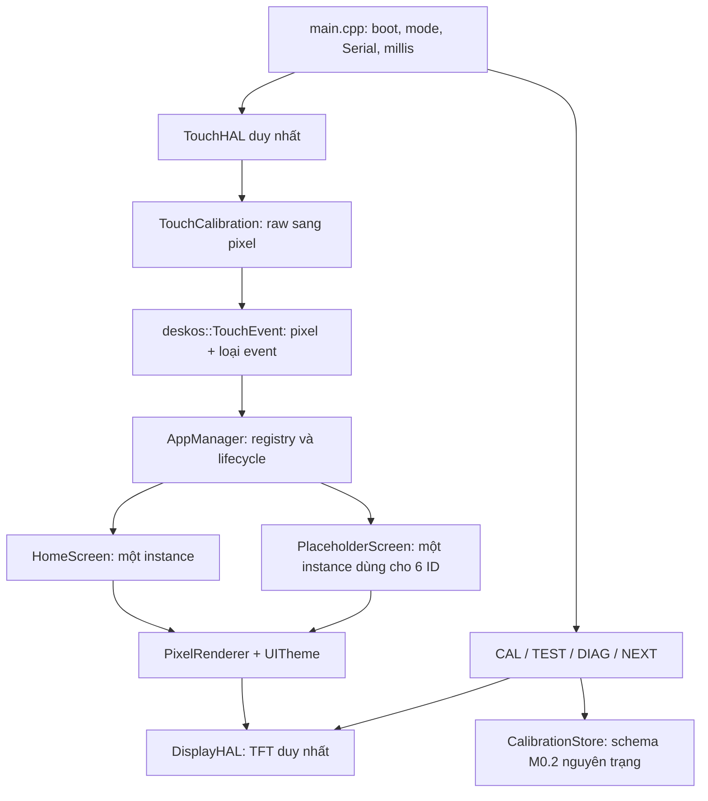

# CYD DeskOS Shell v0.3 — Architecture

Firmware: **M0_SHELL_01**, ngày 2026-11-19 (Asia/Saigon).

M0.0/M0.1/M0.2 đã được người dùng nghiệm thu trên ESP32-2432S028R.
M0.3 hiện mới Clean/Build SUCCESS trên máy; chưa Upload, chưa có kết quả phần cứng.

## Baseline và phần giữ nguyên

Backup trước thay đổi:
[M0_TOUCH_CAL_01_verified_before_M0_3_2026-11-19](baselines/M0_TOUCH_CAL_01_verified_before_M0_3_2026-11-19/).
Có toàn bộ src/include, platformio.ini, BIN/ELF/boot images, log, báo cáo,
SHA256.json và BOARD_CONFIRMATION.md. Hash BIN M0.2:

```text
E924E31902DED52CE1EEA35458047562E4655AFAB9416619922488E34546F912
```

Đã đối chiếu hash: toàn bộ module M0.2 cũ **ngoài main.cpp** không đổi, gồm
DisplayHAL, TouchHAL, TouchTypes, affine/CRC/Preferences store, CalibrationScreen,
TouchTestScreen và DiagnosticScreen. platformio.ini/board_pins.h không đổi.
Giữ ILI9341_2_DRIVER, GPIO, TFT HSPI, touch VSPI, rotation 1, inversion true,
LOAD_GLCD=1, framework và dependency. Không LVGL hoặc instance phần cứng mới.

Backup không chứa bản export NVS của board: agent không đọc/xóa/ghi NVS trên
thiết bị. Schema/key/version calibration vẫn nguyên; nạp firmware bình thường
không có bước erase NVS. NVS chỉ ghi khi người dùng hoàn thành CAL như M0.2.

## Các lớp và ownership



| File mới | Vai trò |
| --- | --- |
| src/core/AppTypes.h | AppId, AppInfo, Rect và sự kiện UI pixel-only |
| src/core/IApp.h | onEnter/update/render/onTouch/onExit, cờ dirty |
| src/core/AppManager.h/.cpp | Registry 7 ID, một active app, deferred transition, gesture gate, log |
| src/ui/UITheme.h | RGB565 palette và layout/hitbox dùng chung cho draw/input |
| src/ui/PixelRenderer.h/.cpp | Pixel icon/panel/button/text/status bar bằng TFT_eSPI hiện có |
| src/apps/HomeScreen.h/.cpp | Lưới 6 icon, highlight và dirty regions |
| src/apps/PlaceholderScreen.h/.cpp | Một màn hình cấu hình theo active ID, BACK/HOME |

main.cpp chỉ thêm orchestration và adapter UI; không chuyển raw vào Home/placeholder.
Không sửa Touch Calibration hoặc DisplayHAL để tích hợp Shell.

## AppManager và lifecycle

IApp định nghĩa:

```cpp
void onEnter();
void update(uint32_t deltaMs);
void render();
void onTouch(const deskos::TouchEvent& event);
void onExit();
```

Các phương thức là virtual; needsRender() dùng cờ dirty để không render mỗi loop.
Registry là mảng cố định 7 con trỏ IApp, không vector/map/String hoặc new mỗi trang.
ID Home trỏ tới HomeScreen; sáu ID còn lại cùng trỏ tới một PlaceholderScreen.
AppInfo/glyph là dữ liệu const; không tạo sáu bản giao diện hoặc sáu framebuffer.

| ID | Ứng dụng | Label |
| --- | --- | --- |
| 0 | DeskOS Home | HOME |
| 1 | Pixel Pet | PET |
| 2 | Pixel Window | WINDOW |
| 3 | Focus Quest | FOCUS |
| 4 | Daily Missions | MISSIONS |
| 5 | PC Monitor | PC MON |
| 6 | Living Weather | WEATHER |

`open(id)` chỉ xếp pending ID. Ở update kế tiếp, AppManager hủy capture cũ,
gọi onExit() của app cũ, đổi active ID/con trỏ, gọi onEnter() app mới, update và
render nếu dirty. Không chuyển lifecycle ngay giữa callback onTouch().
Placeholder đọc active ID trong onEnter(), nên dùng chung instance vẫn nhận
đúng icon/tên. Nếu đã ở cùng ID thì không gọi lại lifecycle hoặc init.

BACK và HOME từ mọi placeholder đều về Home: Shell chỉ có một tầng, chưa có
history stack của app con. Trên Home, BACK bị vô hiệu hóa; HOME là thao tác giữ
ở Home. Đây là navigation Shell, chưa phải chức năng thực tế của sáu ứng dụng.

Khi vào CAL/TEST/DIAG, main gọi suspend(): cancel input và onExit() trước khi
nhường màn hình cho recovery. Chỉ mode hiện tại được update/render. HOME/BACK
qua Serial trở về Home nếu có map hợp lệ, không thì vào CAL.

## Layout và PixelRenderer

| Vùng | Pixel |
| --- | --- |
| Status bar | y=0..31, DESKOS v0.3 + tag tĩnh |
| Content | y=32..199 |
| Navigation | y=200..239 |

Home có 6 card 96×72, tọa độ trái trên:
(8,40), (112,40), (216,40), (8,120), (112,120), (216,120).
Icon 16×16 tự vẽ bằng bảng bit, scale 2 thành 32×32; label GLCD 1 size 1.
BACK=(0,200,156,40), HOME=(164,200,156,40); hitbox cao đủ 40 px.
Draw và hit test dùng cùng Rect, không có bộ tọa độ thứ hai.

Theme RGB gốc chuyển sang RGB565 thông thường, không đổi cấu hình RGB order:

| Màu | Hex RGB |
| --- | --- |
| Background | #171329 |
| Panel | #43355D |
| Mint | #72E6BA |
| Gold | #F3D37A |
| Rose | #F28FAB |

Panel viền pixel cắt góc; pressed dùng nền Mint và nội dung tối để tương phản.
Placeholder có icon scale 3, tên đầy đủ, COMING SOON, BACK/HOME.
Text luôn dùng font GLCD 1 size 1/2 đã bật; không tải font mới.
Không hiển thị giờ hoặc Wi-Fi giả. Không animation phức tạp.

PixelRenderer giữ tham chiếu DisplayHAL, không sở hữu TFT/SPI khác.
Khi đổi trang vẽ lại màn hình. Khi nhấn/thả/cancel, chỉ redraw card hoặc nút
navigation có dirty bit; idle Shell không redraw toàn màn hình.
Sáu glyph chỉ là 6×16×2=192 bytes dữ liệu const, không phải framebuffer.

## Touch integration

Global enum TouchEvent của M0.2 vẫn là bit flags raw-event, không bị đổi API.
Sự kiện của IApp nằm riêng trong namespace deskos để tránh trùng tên, chỉ chứa
Press/Move/Release/Tap/Cancel, x/y pixel, timestamp và heldMs.

1. TouchHAL poll/debounce/tap gate giữ nguyên M0.2.
2. Chỉ khi có calibration hợp lệ mới vào Shell.
3. Adapter main map raw bằng affine đang có trong RAM, rồi tạo sự kiện pixel-only.
4. PRESS chỉ highlight; RELEASE tắt highlight. Chỉ TAP của TouchHAL có thể mở trang.
5. AppManager yêu cầu PRESS→RELEASE→TAP của cùng contact; TAP trùng bị bỏ qua.
6. Dịch chuyển >8 px (khoảng cách Euclidean từ PRESS) hoặc giữ >700 ms sẽ Cancel.
   Rời hitbox gốc cũng hủy target dù di chuyển chưa tới ngưỡng, không tái kích hoạt
   bằng kéo ra rồi vào lại. TouchHAL vẫn có bộ lọc raw movement và TAP cooldown 250 ms.
7. Sau đổi recovery view/Serial HOME, phải nhả ngón cũ trước khi nhận press mới.

Ngưỡng 8 px phân biệt kéo với jitter nhỏ của tap; cần kiểm tra thực tế với
calibration/độ nhiễu của board. Chưa khẳng định chống giữ/kéo PASS trên M0.3.

## Boot, NVS và recovery

Trình tự phần cứng không đổi: display.begin() → touch.begin() → boot log →
display.applyColorConfig() → nạp record NVS. Registry được đăng ký một lần.

- Map hợp lệ: LOADED_FROM_NVS → Home onEnter/render → DISPLAY_READY.
- Map thiếu/hỏng: CalibrationScreen cũ, không dùng raw tọa độ mở Home.
- CAL thành công: store/readback cũ giữ nguyên, sau đó vào Home. Không auto CAL
  khi mở app hoặc trở Home. TEST vẫn mở TouchTestScreen M0.2 theo lệnh.
- DIAG/NEXT/CAL/RETRY/STATUS/TEST giữ nguyên; thêm HOME/BACK. Serial vẫn được
  xử lý ở mọi view, kể cả touch mất phản hồi hoặc mapping sai.
- Không erase/clear/remove NVS mới, không thay namespace/key/version. Không có
  write NVS khi open app, render, update hoặc về Home.

## Scheduling, telemetry và giới hạn

Loop dùng millis() cho delta, TouchHAL, diagnostics và log; cuối loop yield(),
không gọi timed delay. Không đổi watchdog hoặc sdkconfig; cấu hình Arduino đang
cài chạy loop trên CPU1, giữ nguyên cấu hình kiểm tra idle watchdog của SDK.

`APP_SWITCH:` ghi id/label, duration_us, switches, free_heap và largest_free_block
mỗi transition; thời gian đo từ lifecycle cũ đến xong render mới, không gồm thời
gian debounce trước TAP. Boot vào Home cũng tính một transition. Muốn kiểm tra
100 lần chuyển, dùng chênh lệch switches so với mốc sau boot/warm-up.

`MEMORY:` mỗi 5 giây ghi uptime/mode/app/switches/free/largest. App=NONE khi ở
CAL/TEST/DIAG và Shell bị suspend. Raw touch log vẫn theo event hoặc tối đa khoảng
200 ms khi chạm, không theo từng frame. DiagnosticScreen có log riêng như trước.

Chưa có host runtime test lifecycle hoặc test ESP32 cho Shell trong phiên này.
Clean/link và kiểm tra tĩnh không thay thế thử 100 transition, 30 phút, font/dirty
regions/gesture thật. Không có chức năng thực của Pet/Window/Focus/Missions/PC/
Weather, không lưu trạng thái app, không networking/API/NTP/PC Agent hoặc LVGL.

Kết quả build và hướng dẫn nạp/kiểm thử nằm trong [TEST_REPORT_M0.md](TEST_REPORT_M0.md).
