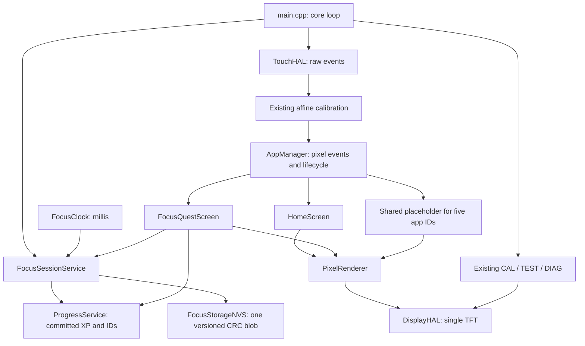
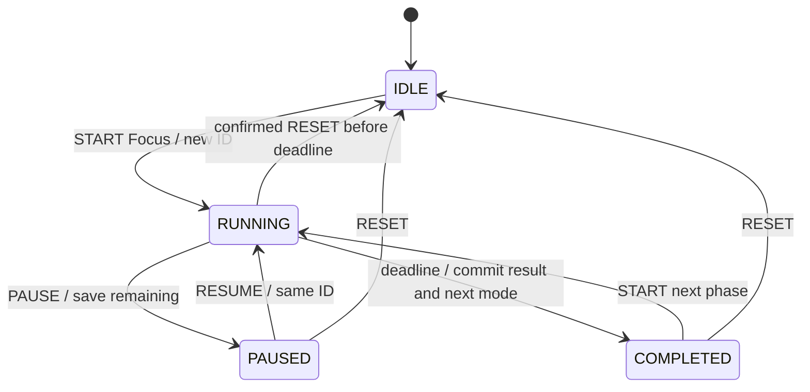

# CYD DeskOS — Architecture M1

Firmware **M1_FOCUS_01**, 2026-11-19, environment `cyd_ili9341`.
M0.0–M0.3 được người dùng nghiệm thu; M0.3 PASS 8/8. M1 đã build và chạy test
host; nghiệm thu ESP32 **PENDING**. Xem [TEST_REPORT_M1.md](TEST_REPORT_M1.md).

## Baseline và phần cứng

Project chưa có Git khi audit. Đã backup 41 file với SHA256.json tại
`docs/baselines/M0_STABLE_before_M1_2026-11-19/`, kiểm tra hash 41/41 khớp,
sau đó tạo commit `654b069`, annotated tag `m0-stable` và branch
`feature/m1-focus-quest`. Không ghi đè tag. Kết quả người dùng nằm trong
[M0_ACCEPTANCE.md](M0_ACCEPTANCE.md); báo cáo M0 cũ giữ như lịch sử.

Giữ nguyên platformio.ini, board_pins, DisplayHAL, TouchHAL, calibration và
AppManager: ILI9341_2_DRIVER, GPIO, TFT HSPI, touch VSPI, rotation 1,
invertDisplay(true), LOAD_GLCD=1, framework và dependencies đã kiểm thử.
Chỉ một TFT, một Touch và một PixelRenderer dùng chung.

Trình tự phần cứng vẫn `display.begin()` → `touch.begin()` →
`display.applyColorConfig()`: init/rotation một lần, inversion true một lần
sau touch init. Không thêm lời gọi đảo màu hoặc sửa schema calibration.

## Ownership và module

| Module | Trách nhiệm |
| --- | --- |
| `src/services/FocusModel.h/.cpp` | Duration 25/5 phút, enums, schema 40 byte, CRC32/validation |
| `src/services/FocusStorage.h` | Interface clock/storage độc lập Arduino để test logic thật |
| `src/services/FocusSessionService.h/.cpp` | Timestamp, state machine, checkpoint, commit/retry completion |
| `src/services/ProgressService.h/.cpp` | XP dùng chung, đếm phiên, cấp ID, chống thưởng trùng |
| `src/storage/FocusStorageNVS.h/.cpp` | Đọc NVS phân loại lỗi; Preferences ghi blob và đọc lại xác minh |
| `src/hal/FocusClock.h` | Adapter millis() cho clock interface |
| `src/apps/FocusQuestScreen.h/.cpp` | View/input; không sở hữu hoặc tự update timer |
| `src/core/AppManager.h/.cpp` | Registry 7 ID, deferred transition, gesture gate M0 nguyên trạng |
| `src/ui/PixelRenderer.h/.cpp` | Thêm fillRegion/progress bar; TFT hiện có; banner DESKOS M1 |
| `src/main.cpp` | Sở hữu service, begin một lần, update mọi loop, registry/log |
| `tests/` | Source production với fake clock/storage và host draw spy |

Registry giữ Home=0, Pet=1, Window=2, Focus=3, Missions=4, PC Monitor=5,
Weather=6. Chỉ Focus là app thật mới; năm ID khác giữ PlaceholderScreen.
Có ba screen instance shell; không tạo sáu bản placeholder.

## Timer và XP

COMPLETED mô tả pha vừa kết thúc; mode và remainingMs đã là pha tiếp theo
chờ START. Hết Focus: Break 05:00, +25 XP và sessions +1. Hết Break: Focus
25:00, không thưởng XP. Không tự START hoặc Skip. RESET về Focus IDLE 25:00,
giữ XP/sessions và ID đã dùng. Pause/Resume giữ ID, không thưởng XP.
Nếu đã đủ thời gian ngay khi nhận Pause/Reset, deadline được xử lý trước.

`remaining = savedRemaining - uint32_t(now - anchor)` chặn về 0; không đếm
loop hoặc trừ từng giây. Checkpoint thành công neo timestamp mới. Phép trừ
unsigned đã test qua rollover. Firmware luôn 25/5 phút, không có short-duration mode.

Core gọi `focusService.update()` trước routing view, độc lập AppManager.
Home, năm placeholder, CAL/TEST/DIAG và suspend không dừng timer.
FocusQuestScreen::onExit chỉ hủy highlight/confirmation; quay lại đọc timer
hiện tại. Không có vòng đếm giờ riêng trong screen.

ProgressService là nguồn committed duy nhất: totalXP, completedFocusSessions,
currentSessionId, lastRewardedSessionId. START Focus cấp ID tăng dần; Break/
Resume không cấp ID. Thưởng chỉ cho current ID chưa được thưởng; ID cũ không
thể cộng lại. Có guard tràn số. API read-only sẵn cho milestone sau.

## Storage và lỗi

Namespace mới `deskos-focus`, key `state`; một blob 40 byte chứa timer, XP,
count, session IDs, magic/version/size, reserved, generation và CRC32.
putBytes commit toàn record, rồi đọc lại/so sánh; không ghi XP/dedup ID ở key
rời. Không clear/remove/erase; `cyd-touch/affine` và schema M0.2 giữ nguyên.

Lưu START/PAUSE/RESUME/RESET/COMPLETE, checkpoint mỗi >=60 giây RUNNING.
Không ghi khi render/đổi trang hoặc mỗi giây. Checkpoint lỗi vẫn giữ timer
RAM chạy đúng; không retry trước 60 giây kế tiếp.

Completion ghi thất bại/không chắc chắn: cache chính snapshot timer+XP+ID,
UI SAVE PENDING, khóa START/RESET và retry cùng record mỗi 5 giây. Không tính
thưởng lại; Progress committed chỉ được publish sau khi xác minh. Home/Back
vẫn hoạt động. Ghi thao tác thường lỗi: STORAGE_WRITE, giữ trạng thái RAM cũ.

Boot RUNNING → PAUSED ở checkpoint cuối, không tính thời gian tắt nguồn và
không ghi chỉ vì boot. PAUSED/IDLE/COMPLETED giữ nguyên. Mất nguồn khi ghi
completion: record hợp lệ cũ yêu cầu resume phần chưa lưu; record mới đã có
XP/dedup nên không thưởng lần hai. Thiết kế này đã test với fake storage;
power-cut/NVS vật lý vẫn PENDING.

Thiếu record: Focus 25:00, 0 XP. Sai CRC/version/shape: INVALID_RESTORE,
fallback mặc định, chưa ghi đè record đến thao tác lưu chủ động của người dùng;
không đoán XP đã mất. Read I/O lỗi: STORAGE_READ, khóa nút timer để không
ghi đè XP chưa đọc được; reboot sau khi xử lý lỗi để đọc lại.

Checkpoint khỏe thường mất tối đa khoảng 60 giây công việc cộng độ trễ loop/
ghi khi mất nguồn. Lỗi ghi kéo dài có thể làm checkpoint cũ hơn 60 giây;
không cam kết giới hạn 60 giây trong trường hợp đó.

## UI, input và hiệu năng

Palette giữ Background #171329, Panel #43355D, Mint #72E6BA, Gold #F3D37A,
Rose #F28FAB. Status y=0..31, content y=32..199, navigation y=200..239.
HOME/BACK giữ Rect/cơ chế M0; Home giữ sáu tile cũ.

Focus có tên, mode/state, XP/sessions, MM:SS GLCD font 1 size 4, progress,
message, hai nút 148×40 tại (8,152)/(164,152). Vẫn font 1 cho mọi text, không
tải font khác. RESET RUNNING yêu cầu RESET rồi CONFIRM trong 5 giây;
CANCEL/timeout hủy. Timer vẫn chạy trong lúc xác nhận.

Input chỉ nhận pixel đã map bằng calibration M0. AppManager giữ PRESS→
RELEASE→TAP, debounce/cooldown, ngưỡng drag/hold và cancel. Screen tiêu thụ
target một lần, giữ ý nghĩa từ PRESS để PAUSE không biến thành START nếu pha
kết thúc trước TAP.

Full clear chỉ khi vào trang. Timer redraw khi giây đổi; progress khi phần
nghìn đổi; details/control khi revision/input đổi. Không framebuffer/sprite
320×240, task timer riêng hoặc cấp phát mỗi frame. NVS I/O đồng bộ tại sự kiện/
checkpoint; không delay dài/busy-wait. Loop giữ yield và bounded Serial parser.

FOCUS log theo revision/STATUS; FOCUS_STORE theo lần ghi/retry; MEMORY mỗi
5 giây free_heap/largest_free_block/uptime/app/switches; APP_SWITCH giữ telemetry
M0. Không log timer mỗi frame. Không thêm Wi-Fi/HTTP/NTP/PC Agent/LVGL hoặc
chức năng năm app còn lại. Xem [FOCUS_QUEST.md](FOCUS_QUEST.md).
