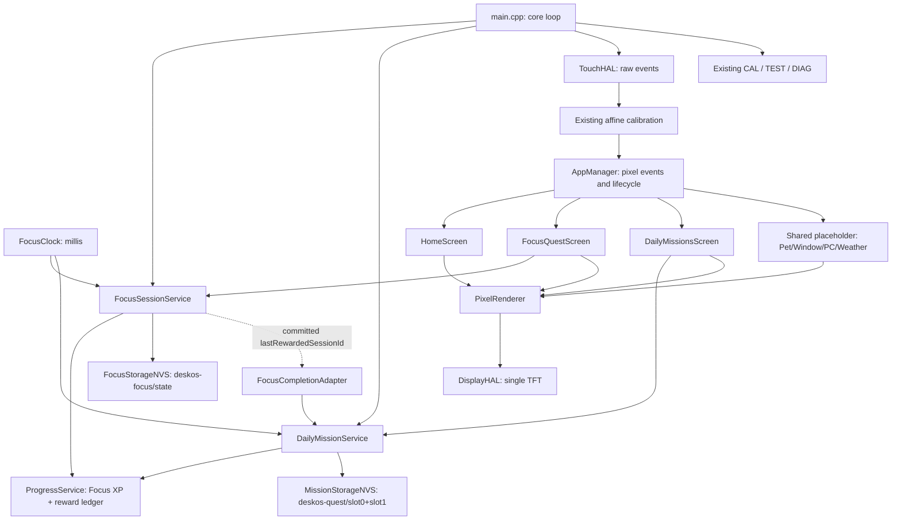

# CYD DeskOS — Architecture M2

Firmware **M2_MISSIONS_01**, 2026-11-20, environment `cyd_ili9341`.
M0 PASS; M1 Focus Quest được người dùng báo PASS hardware acceptance (10/10).
M2 Daily Missions đã build và chạy test host; nghiệm thu ESP32 **PENDING**.
Xem [TEST_REPORT_M2.md](TEST_REPORT_M2.md), [DAILY_MISSIONS.md](DAILY_MISSIONS.md),
[FOCUS_QUEST.md](FOCUS_QUEST.md).

## Baseline và phần cứng

| Mốc | Commit | Tag | Branch |
| --- | --- | --- | --- |
| M0 | `654b069` | `m0-stable` | `main` |
| M1 | `c59cfae` | `m1-stable` (annotated) | `feature/m1-focus-quest` |
| M2 | checkpoint trên branch | — | `feature/m2-daily-missions` |

Build lại `m1-stable` tạo đúng BIN SHA256 `00C4C348…6D59` của TEST_REPORT_M1,
nên tag trỏ tới firmware đã nghiệm thu. Không ghi đè tag nào.

Giữ nguyên platformio.ini, board_pins, DisplayHAL, TouchHAL, calibration,
AppManager, HomeScreen, PlaceholderScreen và toàn bộ service/storage/screen
Focus của M1 (đã kiểm `git diff m1-stable` rỗng cho các file này):
ILI9341_2_DRIVER, GPIO, TFT HSPI, touch VSPI, rotation 1, invertDisplay(true),
LOAD_GLCD=1. Một TFT, một Touch, một PixelRenderer dùng chung. Trình tự
`display.begin()` → `touch.begin()` → `display.applyColorConfig()` không đổi.

## Ownership và module

| Module | Trách nhiệm |
| --- | --- |
| `src/services/ProgressService.h/.cpp` | M1: Focus XP/session IDs. M2: `RewardLedger`, `grantRewardOnce`, `openRewardDay`, `totalXP()` dùng chung |
| `src/services/MissionModel.h/.cpp` | Quest/record schema v1 168 byte, template, title, CRC/validation, chọn slot A/B |
| `src/services/MissionStorage.h` | Interface storage, nguồn FocusCompleted, nguồn ngày lịch (M5) |
| `src/services/DailyMissionService.h/.cpp` | Complete quest, NEW DAY, auto Focus quest, commit/pending/retry |
| `src/services/FocusCompletionAdapter.h` | Adapter chỉ đọc state Focus đã commit; không sửa FocusSessionService |
| `src/services/Crc32.h` | CRC-32 inline giống thuật toán M1 |
| `src/storage/MissionStorageNVS.h/.cpp` | NVS hai slot, ghi xen kẽ, đọc lại so sánh |
| `src/apps/DailyMissionsScreen.h/.cpp` | View/input Daily Quests; không sở hữu dữ liệu |
| `src/ui/PixelRenderer.h/.cpp` | Thêm `drawGlyph8`, `drawCheckbox`, cỡ chữ nút; banner DESKOS M2 |
| `src/main.cpp` | Sở hữu service, begin theo thứ tự, update mỗi loop, registry, Serial |
| Focus M1 (Model/Session/StorageNVS/Clock/Screen) | Nguyên trạng |

Registry giữ Home=0, Pet=1, Window=2, Focus=3, Missions=4, PC Monitor=5,
Weather=6. Missions thay placeholder; bốn ID còn lại dùng chung PlaceholderScreen.
Bốn screen instance trong shell (`SHELL_REGISTRY: READY ids=7 screen_instances=4`).

## XP dùng chung

XP Focus nằm trong record Focus 40 byte của M1 (không đổi layout). Nếu
Missions cộng thẳng vào `ProgressData.totalXP`, commit Focus kế tiếp sẽ
`adopt()` record Focus và xóa mất XP mission. Vì vậy ProgressService có hai
phần committed:

- `ProgressData` (Focus): chỉ FocusSessionService commit, +25/phiên như M1.
- `RewardLedger` (non-Focus): `bonusXP`, `grantedCount`, `openDayId`,
  `rewardedMask`; chỉ DailyMissionService commit.

`totalXP() = focusXP + bonusXP` (bão hòa UINT32_MAX). Focus Quest và Daily
Missions đều hiển thị `totalXP()`. Daily Missions không có biến XP riêng: phần
thưởng chỉ qua `ProgressService::grantRewardOnce()` trên candidate, rồi ghi,
rồi `adoptLedger()` sau khi NVS xác minh (cùng mẫu `rewardFocus` của M1).

Reward key `mission:<dayId>:<questId>`. Ngày `< openDayId` đã đóng vĩnh viễn
(`DayClosed`), ngày `> openDayId` không hợp lệ, trên `openDayId` bit
`questId-1` đánh dấu đã thưởng (`AlreadyRewarded`). Có guard tràn số, XP
1..100/lần, questId 1..32.

## Daily Missions

Chi tiết dùng ở [DAILY_MISSIONS.md](DAILY_MISSIONS.md).

- 5 quest template (questId 1..5, 10 XP); quest 5 COMPLETE FOCUS loại
  `FocusSession` chỉ hoàn thành tự động.
- Completion là cuối cùng trong ngày: không bỏ tick, không thưởng lại.
- `dayId` bắt đầu 1, chỉ tăng bằng NEW DAY có xác nhận. `startNewDay(expected)`
  từ chối nếu `expected != dayId` nên một xác nhận tăng tối đa một ngày.
- NEW DAY: xóa cờ completed, `openRewardDay(day+1)`, giữ bonusXP/grantedCount,
  title, Focus, calibration; neo Focus anchor mới.
- FocusCompleted: `FocusCompletionAdapter` đọc `lastRewardedSessionId`
  (chỉ tăng sau commit +25 XP). Nếu lớn hơn `focusAnchorId` của ngày → hoàn
  thành quest Focus (+10) một lần. Anchor lưu trong record nên reboot giữa
  commit Focus và commit mission được phục hồi ở update đầu tiên.
- M5: `IDaySource::calendarDay()` (TimeService/NTP) — lần đầu chỉ ghi dấu,
  ngày lớn hơn → mở ngày mới, lùi giờ bị bỏ qua. M2 không cung cấp nguồn.

## Storage và lỗi

| Namespace/key | Nội dung | Ghi bởi |
| --- | --- | --- |
| `cyd-touch/affine` | Calibration M0 | TouchCalibrationStore (không đổi) |
| `deskos-focus/state` | Timer + Focus XP/IDs, 40 byte | FocusStorageNVS (không đổi) |
| `deskos-quest/slot0`, `slot1` | MissionRecord v1, 168 byte | MissionStorageNVS (mới) |

MissionRecord: magic/version/bytes, dayId, calendarDay, focusAnchorId,
questCount, 5 QuestSlot (id, rewardXP, kind, flags, title 20 byte đệm 0),
RewardLedger, generation, CRC32. Completion và reward thay đổi trong cùng một
candidate → một `putBytes` → không có trạng thái "đã tick nhưng chưa thưởng".
Validation từ chối reward không có completion.

A/B: mỗi commit ghi slot không chứa record tốt gần nhất, đọc lại so byte; chỉ
đổi slot khi xác minh. Load chọn slot hợp lệ có generation lớn nhất; slot còn
lại hỏng → `RECOVERED_PREVIOUS_SLOT` (lùi tối đa một commit). Lỗi I/O ở bất kỳ
slot → `IO_ERROR`, khóa mọi thao tác ghi để không đè dữ liệu chưa đọc.

Ghi khi: lần boot đầu không có record (một lần, chốt Focus anchor), hoàn thành
quest, NEW DAY, đổi title, lần đầu có ngày lịch (M5). Không ghi khi render, mở
app, đổi trang, boot bình thường.

Ghi lỗi/không chắc chắn: candidate được cache nguyên byte, UI SAVE PENDING,
retry mỗi 5 giây, mọi thao tác mission bị khóa đến khi commit; XP chỉ hiện sau
commit. Record hỏng tất cả slot: INVALID_RESTORE, mặc định ngày 1/0 bonus XP,
không tự ghi đè đến thao tác người dùng (chính sách M1). Sai version = hỏng
(chưa có migration v2).

## UI, input và hiệu năng

Palette giữ Background #171329, Panel #43355D, Mint #72E6BA, Gold #F3D37A,
Rose #F28FAB. Daily Quests: status y=0..31, progress y=32..57, quest list
y=58..199, navigation y=200..239; Rect và static_assert trong
`DailyMissionsScreen.cpp`. BACK/HOME giữ Rect M0.

Hitbox: hàng quest 242×44, PREV/NEXT/NEW DAY 54×44, CONFIRM/CANCEL 136×40,
BACK/HOME 156×40; không chồng lấn. CONFIRM không trùng vị trí NEW DAY (chạm
lặp ở NEW DAY rơi vào CANCEL); CONFIRM cần ≥300 ms sau khi mở; tự hủy sau 5 s;
NEW DAY khóa 3 s sau khi đổi ngày; 500 ms sau khi đóng hộp thoại chặn chạm
xuống hàng quest/nút bên dưới. Ý nghĩa thao tác chốt lúc PRESS (ngày, trạng
thái hộp thoại); đổi giữa PRESS và TAP thì hủy.

Render theo vùng (stats, bar, từng hàng, cột nút, hộp thoại, nav). Clear toàn
màn chỉ khi vào trang. Hiệu ứng pixel: 6 frame × 100 ms quanh checkbox, chỉ vẽ
lại hàng đó. Không framebuffer/sprite, không cấp phát động trong code M2, không
delay. NVS I/O đồng bộ chỉ tại sự kiện người dùng/retry.

Log: `MISSION_RESTORE` lúc boot, `MISSIONS` theo revision, `MISSION_REWARD` khi
grant, `MISSION_STORE` mỗi lần ghi, `QUEST` khi STATUS/MISSIONS; FOCUS, MEMORY
(free_heap/largest_free_block 5 s), APP_SWITCH giữ như M1. Không thêm Wi-Fi/
HTTP/NTP/PC Agent; Pet/Window/Weather/PC Monitor vẫn là placeholder.

## Focus Quest (M1, không đổi)

State machine IDLE/RUNNING/PAUSED/COMPLETED, 25/5 phút, +25 XP mỗi Focus,
checkpoint ≥60 s, completion pending/retry, RUNNING khôi phục thành PAUSED. Mô
tả đầy đủ trong [FOCUS_QUEST.md](FOCUS_QUEST.md) và bản ARCHITECTURE M1 tại tag
`m1-stable`. Thay đổi duy nhất người dùng thấy: số XP trên Focus Quest là XP
dùng chung (Focus + Missions). Loop gọi `focusService.update()` rồi
`missionService.update()` trước routing view, nên cả hai chạy ở mọi màn hình,
kể cả CAL/TEST/DIAG.
