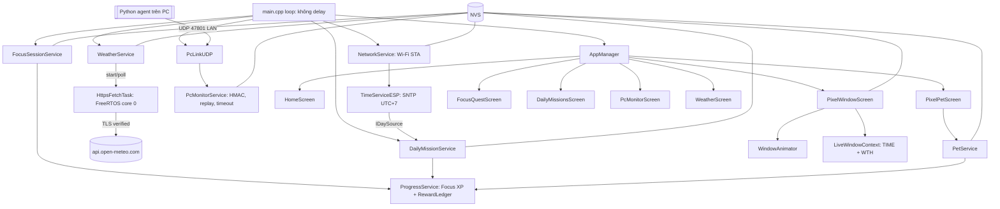

# CYD DeskOS — Architecture (M0–M6, v1.0.0-rc1)

Firmware **DESKOS_1.0.0-RC1**, 2026-11-20, environment `cyd_ili9341`, ESP32-2432S028R.
M0 PASS và M1 PASS trên phần cứng (người dùng nghiệm thu). M2–M6 + RC1: **SOFTWARE PASS**
(build + test host), **HARDWARE PENDING**. Trạng thái chi tiết:
[DEVELOPMENT_STATUS.md](DEVELOPMENT_STATUS.md); kế hoạch thử:
[HARDWARE_TEST_PLAN.md](HARDWARE_TEST_PLAN.md); hướng dẫn: [USER_GUIDE.md](USER_GUIDE.md),
[PC_AGENT_SETUP.md](PC_AGENT_SETUP.md).

## Mốc Git

| Mốc | Commit | Ghi chú |
| --- | --- | --- |
| M0 | `654b069` | tag `m0-stable`, branch `main` |
| M1 | `c59cfae` | tag `m1-stable` (BIN `00C4C348…6D59`, đã nghiệm thu) |
| M2 | `70099fc` | checkpoint, branch `feature/m2-daily-missions` |
| M3 | `592f658` | checkpoint |
| M4 | `200f4ab` | checkpoint |
| M5 | `80d0ebd` | checkpoint |
| M6 | `f44efe0` / `759405e` | checkpoint + tài liệu |
| RC1 | tag `v1.0.0-rc1`, branch `release/v1.0.0` | hardening + tài liệu phát hành |

## Phần cứng không đổi

`git diff m1-stable` rỗng cho platformio.ini, `include/` (board_pins, DisplayHAL),
`src/core/` (AppManager, calibration), `src/hal/` (TouchHAL, FocusClock), Diagnostic,
toàn bộ Focus (model/service/storage/screen), Home, Calibration/Test screens, UITheme.
Giữ ILI9341_2_DRIVER, GPIO, TFT HSPI, touch VSPI, rotation 1, invertDisplay(true),
LOAD_GLCD=1, trình tự `display.begin()` → `touch.begin()` → `applyColorConfig()`.
Một TFT, một Touch, một PixelRenderer. Wi-Fi không dùng GPIO của TFT/touch.
Partition table mặc định giữ nguyên (app 1,310,720 byte; firmware dùng 79.2%).

## Sơ đồ module

Registry: Home=0, Pet=1, Window=2, Focus=3, Missions=4, PC Monitor=5, Weather=6.
Mỗi app là một instance riêng; PlaceholderScreen chỉ còn là fallback không đăng ký.

## Vòng lặp và tác vụ

Thứ tự mỗi loop (core 1): `focusService.update()` → `network.update()` (+ khởi
động SNTP/HTTPS task/token lần đầu có IP) → `missionService.update()` →
`weatherService.update()` → `pcLink.update()` → Serial → touch → view/AppManager.
Mọi service nền chạy ở mọi màn hình (kể cả CAL/TEST/DIAG); đổi app không reset
service. Chỉ app đang hiển thị được `update/render`.

Tác vụ blocking duy nhất (DNS/TLS/HTTP) chạy trong `HttpsFetchTask`: một task
FreeRTOS cố định, stack 12 KB, core 0, **priority 0** (từ RC1: framework bật
task-watchdog panic 5 s theo dõi IDLE0, nên task TLS không được chiếm IDLE0), tạo một
lần khi có IP; giao tiếp bằng state + critical section, buffer URL 256 B và body 2 KB
cố định. Trình tự mỗi request: `WiFiClientSecure::connect` (DNS + TCP + TLS, chain +
hostname) → kiểm ngày chứng chỉ leaf nếu NTP hợp lệ → HTTP/1.0 GET trên kết nối đã
xác thực. Timeout: connect 6 s, handshake 12 s, read 8 s; WeatherService còn watchdog
30 s và gắn request id để bỏ kết quả muộn.

## XP và phần thưởng (M1/M2)

`ProgressService` có hai phần đã commit: `ProgressData` (Focus, trong record Focus
40 byte của M1, không đổi) và `RewardLedger` (Missions, cùng blob với trạng thái
quest). `totalXP()` = Focus + Missions (bão hòa). Pet chỉ đọc XP. Reward key
`mission:<dayId>:<questId>` idempotent; completion + reward trong một commit;
FocusCompleted qua adapter đọc `lastRewardedSessionId`. Chi tiết:
[DAILY_MISSIONS.md](DAILY_MISSIONS.md), [FOCUS_QUEST.md](FOCUS_QUEST.md).

Từ M5, khi SNTP đã đồng bộ trong lần boot hiện tại, Daily Missions tự mở ngày mới
lúc 00:00 giờ Việt Nam (UTC+7); NEW DAY thủ công vẫn dùng được.

## NVS (schema có version + CRC32)

| Namespace/key | Nội dung | Mốc | Khi ghi |
| --- | --- | --- | --- |
| `cyd-touch/affine` | Calibration | M0 | Chỉ khi CAL thành công |
| `deskos-focus/state` | Timer + Focus XP, 40 B | M1 | Start/Pause/Resume/Reset/Complete, checkpoint ≥60 s |
| `deskos-quest/slot0,slot1` | Quests + ledger, 168 B, A/B | M2 | Hoàn thành quest, NEW DAY, đổi title, ngày lịch |
| `deskos-pet/state` | Style, số lần vuốt, XP đã thấy, 24 B | M3 | Rời app (nếu đổi), đổi style |
| `deskos-win/state` | Scene + speed, 16 B | M4 | Rời app (nếu đổi) |
| `deskos-wthr/loc` | Vị trí, 36 B | M5 | Lệnh `WEATHER LOC` |
| `deskos-wthr/cache` | Thời tiết gần nhất, 32 B | M5 | Mỗi lần fetch thành công (≥15 phút) |
| `deskos-net/ssid,pass,en` | Wi-Fi (string) | M5 | Lệnh `WIFI …` |
| `deskos-pc/token` | Token 128-bit, 28 B | M6 | Lần đầu có Wi-Fi / `PC TOKEN NEW` |
| `deskos-pc/ctr` | Replay floor (counter + tag token), 24 B | RC1 | Gói hợp lệ đầu tiên mỗi boot, sau đó ≤ 1 lần/15 phút, chỉ khi có NTP |

Không có lệnh erase. Mỗi record được validate (magic/version/size/CRC/range); hỏng
→ mặc định của riêng record đó, không ảnh hưởng record khác. Blob ghi qua
`BlobStoreNVS`/adapter riêng, đọc lại so byte. Wi-Fi SDK chạy `persistent(false)`
nên không tự lưu bản sao credentials.

## Mạng và bảo mật

- Wi-Fi chỉ khởi tạo khi đã có SSID trong NVS và đang bật; không có secrets trong
  source/Git (`.gitignore` thêm mẫu secrets). Mật khẩu không bao giờ được in ra.
- Reconnect: auto-reconnect của SDK + `WiFi.begin` lại theo backoff 10 s → 2 phút.
- HTTPS Open-Meteo: `WiFiClientSecure` với `ROOT_CA_BUNDLE` (ISRG Root X1/X2, GTS
  Root R1, DigiCert Global Root G2, trích nguyên văn từ Mozilla bundle). Kiểm tra
  chain + hostname luôn bật; không dùng `setInsecure`. mbedTLS của framework không
  kiểm ngày (`MBEDTLS_HAVE_TIME_DATE` tắt) nên RC1 kiểm `notBefore/notAfter` của leaf
  sau handshake bằng `certDateStatus()` (`TimeModel.h`) khi NTP hợp lệ; log
  `cert_date=VALID|EXPIRED|NOT_YET_VALID|BAD_DATE|DATE_UNCHECKED_NO_NTP`.
- NTP: pool.ntp.org / time.google.com / time.cloudflare.com, TZ `<+07>-7`.
  `valid()` chỉ đúng sau callback sync trong lần boot này.
- PC Monitor: UDP 47801 nhận-only, chỉ khi Wi-Fi lên; chỉ chấp nhận nguồn cùng
  subnet; giới hạn 20 gói/s; HMAC-SHA256 (constant-time compare) trước khi đọc
  field; counter tăng dần chống replay, với floor lưu NVS để reboot không mở lại
  toàn bộ không gian counter (RC1); lệch giờ ≤300 s khi đồng hồ hợp lệ; chỉ
  parse số vào struct cố định — không có lệnh, không có thực thi. Agent chỉ gửi.

## UI và hiệu năng

Palette #171329/#43355D/#72E6BA/#F3D37A/#F28FAB, GLCD font 1. Status y=0..31,
content y=32..199, BACK/HOME y=200..239 (Rect M0). Mọi app: clear toàn màn chỉ khi
vào app, sau đó vẽ lại theo vùng bẩn. Sprite ký tự 16×16 (`drawCharSprite`) vẽ cả
ô nền nên không nhấp nháy, không framebuffer. Window clip theo 4 ô kính và khôi
phục dải màu trời. Animation dựa trên thời gian, giới hạn bước mỗi update.

Test host chứng minh: không có cấp phát heap trong update/render/touch ổn định
(bộ đếm `operator new`), mọi lệnh vẽ trong 320×240, khung cửa sổ không bị vẽ đè.

Bộ nhớ tĩnh (RC1): RAM 52,892 / 327,680 B; Flash 1,038,365 / 1,310,720 B. Heap
runtime (Wi-Fi ~40–60 KB, TLS handshake ~40 KB tạm thời) cần đo trên board qua log
`MEMORY … largest_free_block min_free_heap loop_stack_free` và
`HTTPS: … heap= max_block= min_heap= stack_free=`; công cụ
`tools/hw_validation/deskos_serial_log.py analyze` tóm tắt xu hướng.
