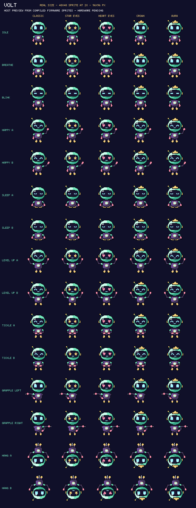
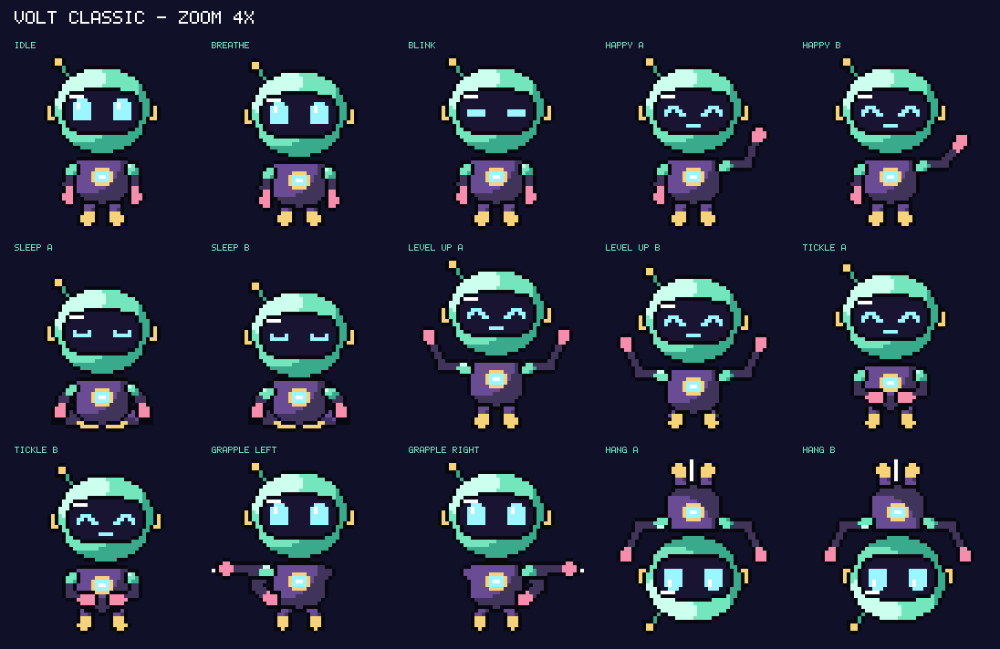

# VOLT — Pixel Pet của DeskOS — 2026-11-23

Bản sửa trên nền `DESKOS_1.0.0-RC1` / commit `cca82de`, chưa phát hành, chưa tag.
**SOFTWARE PASS / HARDWARE PENDING** cho hình ảnh, timing và cảm ứng của pet.

## Nhân vật

VOLT là mascot nguyên bản của DeskOS: robot anh hùng tí hon, nhìn thẳng, 48×48 phóng 2× = 96×96
(vị trí và các nút của app PET không đổi). Dùng đúng bảng màu Retro Pixel của DeskOS.

- **Đầu:** mũ bạc hà (#72E6BA) đổ bóng 3 tông; kính visor tối hiển thị **mắt LED** xanh sáng;
  ăng-ten và tai bu-lông vàng.
- **Thân:** tím (#6A4F95 / #43355D) có lõi năng lượng phát sáng ở ngực, đệm vai bạc hà, găng
  hồng (#F28FAB), ủng vàng (#F3D37A).
- **Màu:** 11 màu + nền (`src/ui/PetSpriteData.h`).

Trước khi đẩy lên repo công khai, các bản prototype pet dựa trên nhân vật có bản quyền đã được thay
hoàn toàn bằng VOLT; source, ảnh và tài liệu không còn dùng nhân vật đó.

| Trạng thái | Frame A | Frame B | Nhịp |
| --- | --- | --- | --- |
| IDLE | Đứng | Thở: đầu và vai hạ 1 hàng | 600 ms; chớp mắt LED 150 ms mỗi 3,2 s |
| HAPPY (xoa đầu) | Giơ tay vẫy, mắt ^ ^ + miệng cười | Bàn tay hất ra | 250 ms; tim ở lề |
| SLEEP | Ngồi xếp bằng, tay trên gối, mắt ‿ ‿ | Đầu gục thêm 1 hàng | 900 ms; Z ở lề |
| CELEBRATE | Hai tay giơ cao | Nhún người, gối mở | 250 ms; tia sáng ở lề |
| TICKLE (cù bụng) | Ôm bụng cười | Đầu lắc sang bên | 150 ms trong 1,8 s; chữ "HA!" ở lề |
| GRAPPLE (bắn móc cáp) | Duỗi tay về trái/phải, cáp ra mép sprite | — | 1,8 s; cáp nối tiếp ra lề + móc neo vàng |
| HANG (treo ngược) | Lộn ngược trên cáp, tay buông xuống | Đung đưa sang phải 2 ô | 400 ms trong 4 s; cáp nối lên mép trên |

Style và mức mở khóa không đổi:

| Style | Mở ở | Hiển thị |
| --- | --- | --- |
| CLASSIC | LV1 | Mắt LED xanh |
| STAR EYES | LV3 | Mắt sao vàng |
| HEART EYES | LV5 | Mắt tim hồng |
| CROWN | LV7 | Vương miện đi theo đầu |
| AURA | LV10 | Vương miện + tia sáng ở lề |

## Tương tác chạm

| Thao tác trong vùng pet | Phản ứng | PETS | Lời nhắn |
| --- | --- | --- | --- |
| Chạm **đầu** | Vẫy tay + tim | +1 | `VOLT LOVES PETS (n)` |
| Chạm **bụng/thân** | Cười, ôm bụng, lắc | +1 | `HAHA! THAT TICKLES (n)` |
| Chạm **khoảng trống bên trái/phải** | Bắn móc cáp về phía đó | — | `ZAP! GRAPPLE LEFT/RIGHT` |
| **Vuốt** qua người (> 8 px) | Xoa đầu: vẫy + tim | +1 | `VOLT LOVES PETS (n)` |
| **Giữ** yên > 0,7 s | Treo ngược đung đưa 4 s | — | `JUST HANGING AROUND...` |
| Bất kỳ thao tác khi đang ngủ | Tỉnh dậy rồi phản ứng | như trên | `VOLT WOKE UP` |

Lời nhắn mặc định: `TAP HEAD/BELLY/SIDE, SWIPE OR HOLD`.

**Cách nhận thao tác:**

- `AppManager` không đổi. Nó vẫn huỷ một lần chạm khi ngón tay đi > 8 px hoặc giữ > 700 ms,
  và gửi `Cancel` kèm toạ độ và thời gian giữ.
- Màn PET đọc `Cancel` đó: đi xa thì coi là vuốt, đứng yên lâu thì coi là giữ.
- `Cancel` do chuyển app (toạ độ 0,0) bị bỏ qua.

**Dữ liệu:**

- Phản ứng chỉ là trạng thái hiển thị (`PetReaction` trong RAM): không ghi NVS, không cộng XP.
- PETS chỉ lưu khi rời app, record `deskos-pet/state` 24 B version 1 giữ nguyên.

## Ảnh xem trước (dựng từ chính mã C++ của firmware)

15 mẫu (trạng thái + phản ứng) × 5 style ở kích thước thật 96×96:



Phóng 4× bản CLASSIC:



Ảnh không mô phỏng phần vẽ ở lề (tim, Z, cáp ngoài sprite, "HA!"), SPI, màu thật của panel hay
cảm ứng. Tạo lại bằng `python tools/preview_pet.py`.

## Triển khai

| File | Nội dung |
| --- | --- |
| `tools/pet_art/generate_pet.py` | Nguồn của hình: dựng khối (ellipse, squircle, capsule, đa giác), đổ bóng, viền. Sinh `PetSpriteData.h`. Tự kiểm: ghép lớp = vẽ trực tiếp cho mọi pose/mắt/vương miện, mắt LED luôn nằm trên visor, vương miện không đè tay/thân. `--check` báo lỗi nếu dữ liệu bị sửa tay; `--preview` xuất ảnh nhanh |
| `src/ui/PetSpriteData.h` (sinh tự động) | 12 frame, 6 kiểu mắt LED, vương miện, bảng 11 màu RGB565, `HEAD_BOTTOM`, `CABLE_HAND_Y` |
| `src/ui/SpriteInk.h` | Kiểu `{ký tự, màu RGB565}` |
| `src/ui/PetSprites.h/.cpp` | 14 pose (Hang/HangSwing = lật dọc frame Cheer tại chỗ + cáp); `petFrame()` có tham số phản ứng |
| `src/ui/PixelRenderer.h/.cpp` | `drawCharSprite` nhận bảng màu nhiều tông (bản `SpritePalette` của Weather giữ nguyên); icon Home đầu robot |
| `src/services/PetModel.h`, `PetService.h/.cpp` | `PetReaction`, `react()`, hết hạn 1,8 s / 4 s, đánh thức, sự kiện `Tickled/Grapple/Hanging` |
| `src/apps/PixelPetScreen.h/.cpp` | Phóng 2×, buffer `PetCanvas` 2.352 B tĩnh, vùng chạm, vuốt/giữ, hiệu ứng lề, tên VOLT |
| `tests/pet_tests.cpp`, `tests/fakes/TFT_eSPI.h`, `tests/run_all_tests.ps1` | P06–P08; theo dõi chữ trên màn; chạy `generate_pet.py --check` |
| `tools/preview_pet.py` | Ảnh kích thước thật và phóng 4× |

Không đổi:

- `AppManager`, phần cứng, touch/calibration, Focus, Missions, Wi-Fi, token PC, thời tiết.
- XP/level, bảng mở style, schema NVS.

`git diff HEAD` rỗng cho `platformio.ini`, `include`, `src/hal`, `src/core`, `src/storage`,
`src/net`, `src/main.cpp`. Trong `src/services`, chỉ `PetModel.h` và `PetService.*` đổi.

**Hiệu năng:**

- Không cấp phát heap (P05/P08 đếm `operator new` = 0).
- Không xóa toàn màn khi animation; chỉ vẽ lại vùng 96×96 khi frame đổi.
- Mỗi hàng gộp các ô cùng màu thành một `fillRect`.

## Kiểm chứng trên máy

Số liệu build/test ở [log build](PET_build.log) và [log test](PET_tests.log); tóm tắt trong
[DEVELOPMENT_STATUS.md](DEVELOPMENT_STATUS.md).

**P06** kiểm mọi tổ hợp pose × mắt × vương miện:

- **Màu:** đủ màu mũ, thân, viền, visor, vàng, hồng.
- **Mắt LED:**
  - số ô LED đúng theo từng biểu cảm (sao vàng, tim hồng);
  - mũ và mắt đối xứng ở các pose đối xứng.
- **Vương miện:** đi theo đầu.
- **Pose:**
  - hai ủng tách khi đứng;
  - ngồi xếp bằng khi ngủ;
  - tay giơ đúng khi vẫy/ăn mừng;
  - cáp ra mép khi bắn móc.
- **Treo ngược:** đúng bằng Cheer lật dọc cộng cáp; frame đung đưa dời đúng 2 ô.
- **Frame key:** mỗi tổ hợp một khóa riêng.

**P07:** mọi chữ trên màn dùng tên VOLT, không còn tên pet cũ; XP cực đại vẫn vừa khung.

**P08** kiểm tương tác:

- **Chạm:**
  - đầu → xoa đầu;
  - bụng → cù;
  - hai bên → móc cáp trái/phải.
- **Vuốt và giữ:**
  - vuốt → xoa đầu, không bị tính thêm tap;
  - giữ → treo 4 s;
  - giữ trên nút STYLE không kích hoạt pet.
- **Đánh thức:** cù khi ngủ → tỉnh.
- **Không tác dụng phụ:**
  - XP không đổi;
  - không ghi NVS khi đang ở màn;
  - 0 cấp phát heap;
  - không vẽ ra ngoài màn hình.
- **Chuyển app:** chuyển app giữa chừng không gây phản ứng.

## Trạng thái trên board

Board (COM6) đang chạy bản prototype trước VOLT. Các bản đó đã được nạp theo yêu cầu chủ board
ngày 2026-11-21, không erase NVS; log đã che secrets: `PET_round1..4_upload.log` /
`PET_round*_serial.log`. Calibration, XP, PETS, Wi-Fi, thời tiết và PC Monitor được giữ qua
mọi lần nạp. **VOLT chưa được nạp.**

Nạp VOLT (đóng Serial Monitor trước, không erase):

```powershell
& "$env:USERPROFILE\.platformio\penv\Scripts\pio.exe" run -e cyd_ili9341 -t upload --upload-port COM6
```

Sau khi nạp:

1. Mở PET: VOLT đứng thở, chớp mắt LED.
2. Chạm đầu → vẫy + tim. Chạm bụng → cười + "HA!".
3. Chạm hai bên → móc cáp đúng phía. Vuốt → xoa đầu. Giữ ~1 s → treo ngược.
4. Nhấn SLEEP → ngồi ngủ + Z; chạm bụng → tỉnh.
5. Kiểm tra STYLE/SLEEP/BACK/HOME, không nhấp nháy, XP không đổi.
6. Khởi động lại: PETS, style, XP giữ nguyên.
7. Gửi ảnh/video và kết quả P01–P08 trong [kế hoạch phần cứng](HARDWARE_TEST_PLAN.md).
